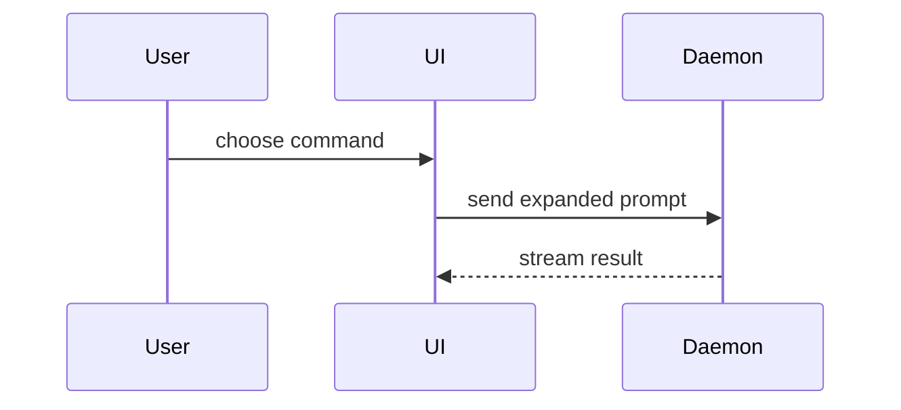
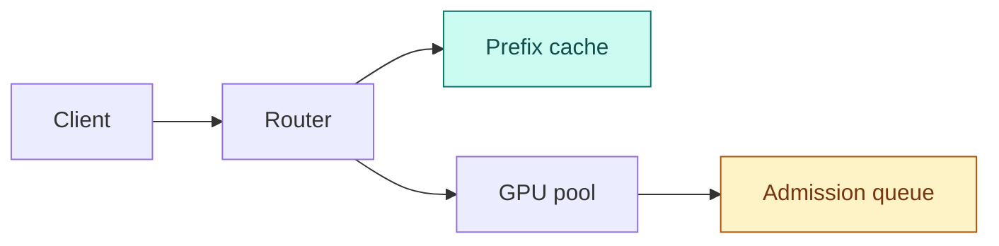

The reader should get the thesis in ten seconds, the shape of the system in sixty, and the mechanics only when they go looking. Every rule below serves that ladder.

## Structure

- **BLUF.** Open with two or three sentences: the problem, the mechanism that solves it, the result. Nothing precedes them but metadata.
- **Ladder of abstraction.** Descend in order: the **bottleneck** (the constraint that makes the problem hard), then the system as a black box, then the mechanics. State why before how.
- **Details on demand.** Raw benchmark tables, hyperparameter grids, verbose payloads, and secondary proofs go in a `<details>` block or a closing `## Appendix`.
- **Contiguity.** Each diagram, table, or code block sits directly under the sentence that introduces it.

## Prose

- **Name the actor.** "The scheduler evicts the oldest batch", with the component as the subject of the verb.
- **Concrete and sourced.** Pair each claim with its runtime reality: the number, the unit, the payload. Every figure traces to a source and carries its citation. A figure you construct to illustrate is labelled _illustrative_. Where the source gives no number, say the source gives none.
- **Real examples.** Use the domain's own names, shapes, and sizes, drawn from the sources or the codebase in front of you.
- **MECE lists.** A list of failure modes, trade-offs, or components covers the space once: no overlaps, no gaps.
- **Front-loaded bullets.** Open a bullet with a bold one-to-three word label, then one or two sentences.
- **Brief.** Skip the preamble. Keep only the calls, files, states, and boundaries the reader needs for the point at hand.

## Choosing a view

Match the view to the shape of the data, and pick the smallest one that makes the point. One view is common, several is fine, all of them is a mistake.

| Shape of the point | View |
| --- | --- |
| Logic or an algorithm | pseudocode |
| Runtime control flow | call tree |
| UI structure | component tree, with state and module boundaries that matter |
| File responsibility, a broad refactor | shallow file tree with `# responsibility` comments |
| Interaction, control or data flow, topology | Mermaid (`flowchart`, `sequenceDiagram`) |
| A multi-variable comparison | table |
| A state or data mutation | before and after blocks |
| A change to a shape that already exists | `diff` over any of the above |
| Mostly new code, or a copyable target | the whole block |

Pseudocode:

```text
on(save)
  if content is unchanged
    return cached result
  write new content
  return fresh result
```

Call tree:

```text
submitForm
  createSession
    persistPrompt
    launchAgent
  navigateToSession
```

Component tree:

```text
<SessionPage> (apps/example/src/routes/session.tsx)
  useSessionEvents()
  <SessionToolbar>
    <RunSkillButton> (packages/ui)
```

File tree:

```text
src/
├── commands/       # parses user actions
├── sessions/       # owns session state
└── transport/      # sends API requests
```

Mermaid, for interaction:



A `diff` takes the shape of whatever it changes. For a component change:

```diff
 <SessionPage>
   useSessionEvents()
   <SessionToolbar>
+    <RunSkillButton />
   <SessionTimeline>
+    <SkillResultCard />
```

For a file-layout change:

```diff
 src/
 ├── commands/
+│   └── show-me.ts       # expands the slash command
 ├── sessions/
-└── transport.ts
+└── transport/
+    ├── client.ts
+    └── stream.ts
```

For a state or control-flow change:

```diff
 on(save)
-  write content
+  if content is unchanged
+    return cached result
+  write new content
+  invalidate cache
```

For a call tree:

```diff
 submitForm
   createSession
     persistPrompt
+    expandSkillMention
     launchAgent
-  navigateToSession
+  navigateToSession
+    subscribeToEvents
```

Show the whole block instead when most of it is new, or when omitted context would hide ownership or order.

```ts
function expandSkill(command: string): string {
  const skillName = command.slice(1);
  return `use the ${skillName} skill`;
}
```

### Tables

Cells hold numbers with units (`ms`, `GB/s`, `tokens/s`) and `Yes`/`No`, not prose. One row per option, one column per variable. A cell the sources leave empty says `n/a`, never a guess.

### Before and after

For a mutation, show the literal state twice and let the reader diff it:

```json
// Before
{ "cache": { "entries": 4096, "evicted": 0 } }
```

```json
// After
{ "cache": { "entries": 3584, "evicted": 512 } }
```

### Diagrams

- **Six to eight nodes.** A topology that needs more becomes an **exploded view**: a macro diagram of about five nodes, then a second diagram of the one component that matters, usually the bottleneck.
- **Data-ink.** No decorative styling, no labels that restate the node. Where size or length encodes anything, it is proportional to the real quantity.
- **Colour by role.** Colour carries meaning or is absent. Leave ordinary nodes unstyled so they take the renderer's theme. Style only the two roles below, always with an explicit text colour, so the node reads on light and dark backgrounds alike:



- **`novel`** (teal) marks the mechanism the material introduces.
- **`bottleneck`** (amber) marks a constraint, a failure state, or a latency wall, and nothing else.

In HTML the same roles hold: slate for ordinary structure, teal `#0f766e` for the novel mechanism, amber `#b45309` for bottlenecks. A host product's palette may supply the neutrals and the type; the two roles keep their colours.

## Widgets

When a point turns on a variable the reader should feel by dragging it, read [WIDGETS.md](WIDGETS.md) before building anything.
